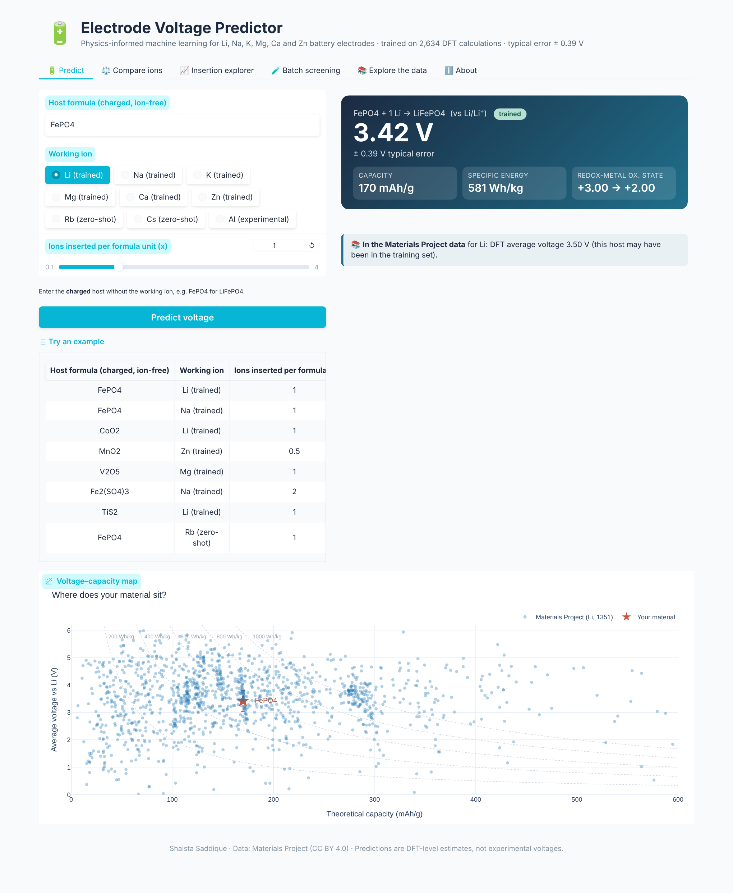
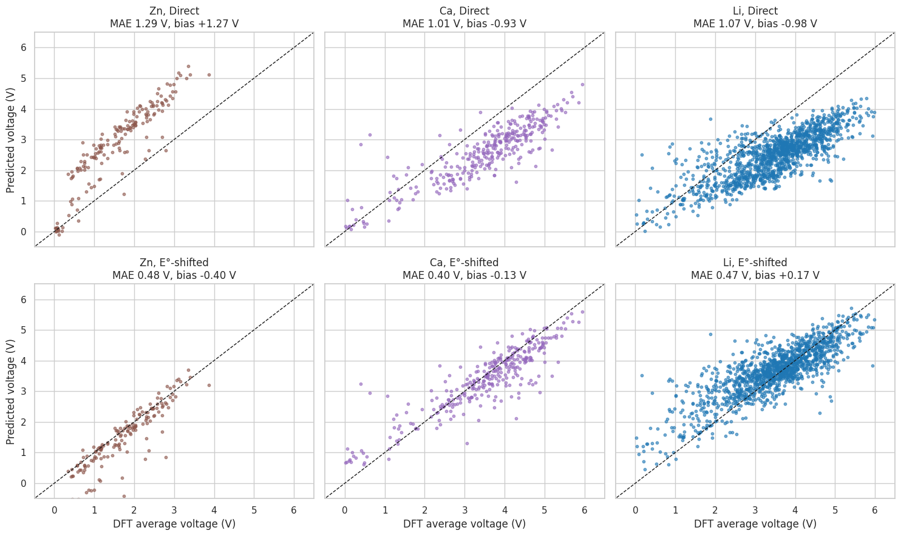
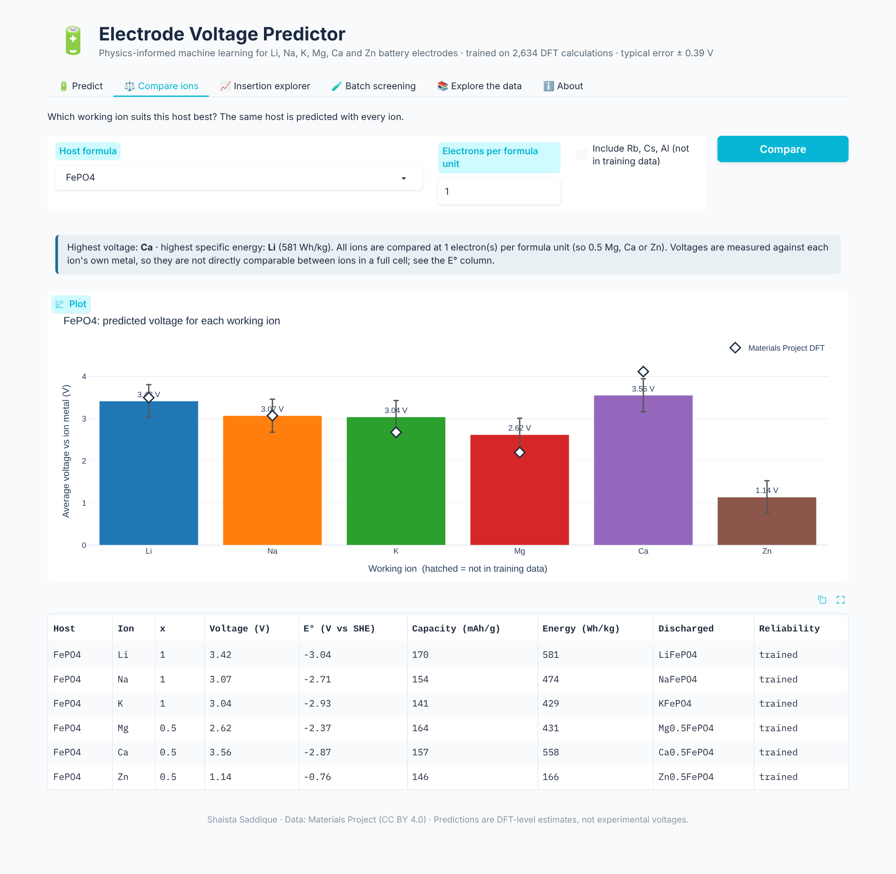
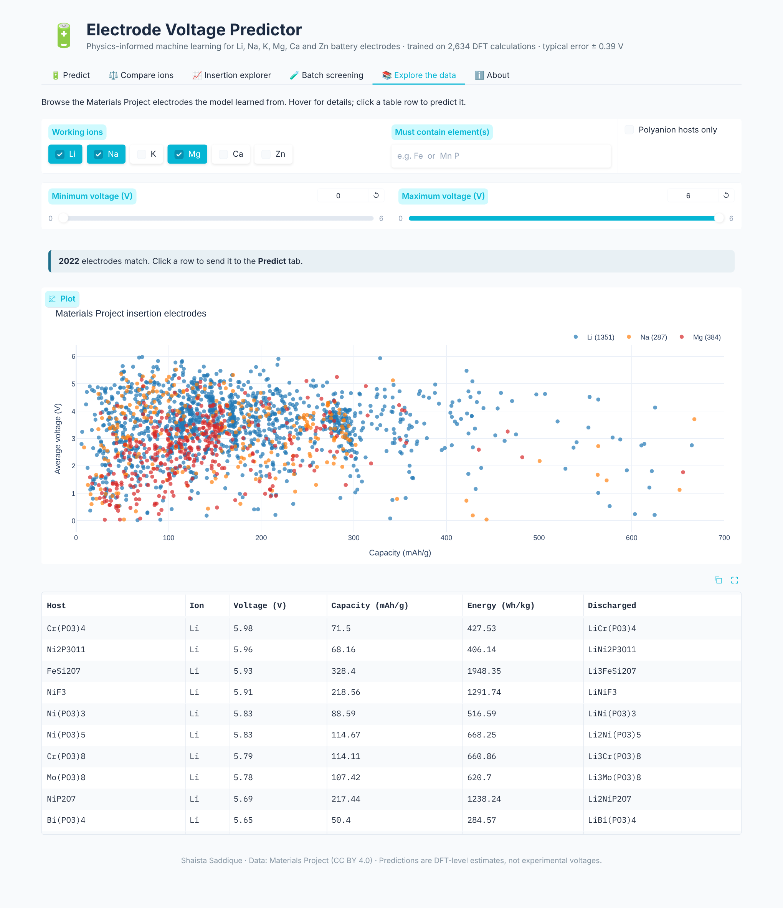
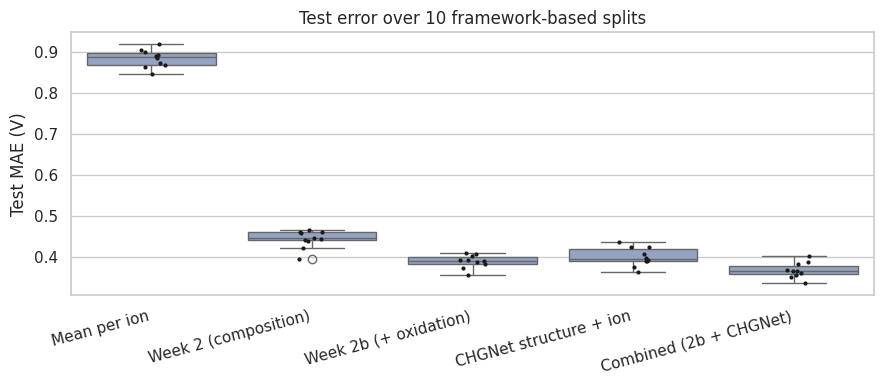
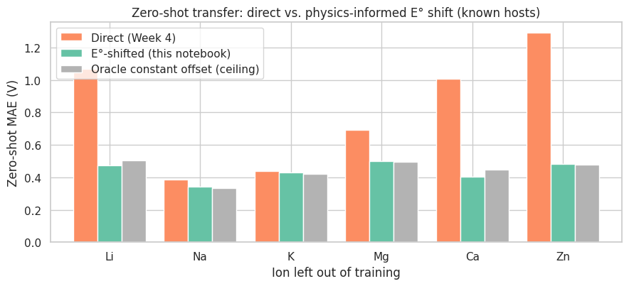

# 🔋 Physics-Informed Machine Learning of Battery Electrode Voltages

**From composition to cross-ion transfer.** A machine-learning model that predicts the average voltage of
battery insertion electrodes for **Li, Na, K, Mg, Ca and Zn** from the chemical formula alone. It is trained on
2,634 DFT calculations from the Materials Project, and comes with an interactive web app.

[](https://www.python.org/)
[](LICENSE)
[](https://materialsproject.org)
[](app/)

<p align="center"></p>

---

## Highlights

| | |
|---|---|
| **Accuracy on unseen host materials** | MAE **0.37–0.39 V** over 10 framework-grouped splits (R² = 0.82) |
| **Physics-informed transfer** | Training on the host potential *E* = *V* + E°(ion) **halves the error for ions never seen in training** (0.81 → 0.44 V) |
| **Offset removed** | 96–108 % of the zero-shot offset error removed for Zn, Mg, Li and Ca, with no target-ion data |
| **Runs anywhere** | Every notebook runs on free Google Colab; the app runs on a laptop CPU |

## The key idea

A battery voltage is measured against the metal of its *own* working ion (Li/Li⁺, Zn/Zn²⁺, …), so every ion has a
different zero point. A model trained on voltages directly cannot know that zero point for an ion it has never
seen, and fails by about 1 V for Li, Ca and Zn. Shifting each voltage by the ion's standard electrode potential puts
all ions on one scale (vs. the standard hydrogen electrode):

$$E_\text{host} = V + E^\circ(\text{ion}), \qquad V_\text{pred} = E_\text{host,pred} - E^\circ(\text{ion})$$

The model then learns a property of the host material and needs only the tabulated E° of a new ion.

<p align="center"></p>
<p align="center"><sub>Zero-shot predictions for Zn, Ca and Li before (top) and after (bottom) the E° shift.</sub></p>

## Interactive app

The **Electrode Voltage Predictor** has six tabs:

| Tab | What it does |
|---|---|
| 🔋 **Predict** | Voltage, capacity, specific energy and redox-metal oxidation states for one host and ion, with the material placed on the voltage–capacity map of all Materials Project electrodes |
| ⚖️ **Compare ions** | The same host with every working ion, at equal electrons per formula unit, with DFT reference points |
| 📈 **Insertion explorer** | How average voltage and specific energy change as more ions are inserted |
| 🧪 **Batch screening** | Paste or upload up to 500 formulas, filter by voltage, sort by energy and download a CSV |
| 📚 **Explore the data** | Filter the 2,880 Materials Project electrodes by ion, voltage and elements; click a row to predict it |
| ℹ️ **About** | Method, accuracy per ion and limitations |

<p align="center">


</p>

### Run it locally

```bash
git clone https://github.com/shaistasaddique/electrode-voltage-ml.git
cd electrode-voltage-ml/app
pip install -r requirements.txt
python app.py            # then open http://127.0.0.1:7860
```

### Run it on Google Colab

```python
!git clone https://github.com/shaistasaddique/electrode-voltage-ml.git
%cd electrode-voltage-ml/app
!pip install -q -r requirements.txt
import os; os.environ["GRADIO_SHARE"] = "1"   # prints a public link
!python app.py
```

### Host it permanently (Hugging Face Spaces)

Create a new **Gradio** Space and upload the contents of the [`app/`](app/) folder. The `app/README.md` file
already contains the Space settings. See [docs/DEPLOY.md](docs/DEPLOY.md) for step-by-step instructions.

### Use it from Python

```python
import sys; sys.path.insert(0, "app")
import core
p = core.predict_one("FePO4", "Li", 1)
print(p.voltage, p.capacity, p.energy)        # 3.42 V, 170 mAh/g, 581 Wh/kg
```

## Results

| Stage | What was added | Test MAE (V), 10 splits |
|---|---|---|
| Reference | Mean voltage of each ion | 0.884 ± 0.021 |
| Composition | Statistics of the host elements and ion properties | 0.445 ± 0.022 |
| + Oxidation states | Redox-metal oxidation state from charge balance | 0.391 ± 0.016 |
| + Structure | Pretrained CHGNet crystal fingerprints | 0.368 ± 0.019 |

The app uses the composition + oxidation-state model with the E° shift (MAE 0.39 V). It needs only a formula,
so no crystal structure or GPU is required.

<p align="center">


</p>

The full write-up, with all 14 figures, is in [**report/Electrode_Voltage_ML_Book.pdf**](report/Electrode_Voltage_ML_Book.pdf).

## Repository structure

```
electrode-voltage-ml/
├── app/                         Interactive Gradio app (also a ready-to-upload Hugging Face Space)
│   ├── app.py                   User interface (6 tabs)
│   ├── core.py                  Prediction logic, usable from Python
│   ├── featurize.py             Features, identical to training
│   ├── voltage_model_e0.json    Trained XGBoost model (E°-shifted target)
│   ├── app_metadata.json        Feature list and accuracy figures
│   ├── reference_voltages.csv   Materials Project electrodes used for the map and explorer
│   └── requirements.txt
├── notebooks/                   The full project, one notebook per week (Google Colab)
│   ├── week1_electrode_voltage_data.ipynb       Download and clean the data
│   ├── week2_baseline_model.ipynb               Composition baseline
│   ├── week2b_oxidation_features.ipynb          Oxidation-state features
│   ├── week3_chgnet_structure.ipynb             CHGNet structure fingerprints
│   ├── week4_transfer_robustness.ipynb          Repeated splits, zero- and few-shot transfer
│   ├── week4b_reference_correction.ipynb        The E° reference shift
│   └── week5_build_app.ipynb                    Train the final model and export the app
├── src/oxfeat.py                Charge-balance oxidation-state features
├── figures/                     All figures from the report
├── report/                      Full report (PDF)
├── tests/test_core.py           Automated tests for the app logic
└── docs/                        Screenshots and deployment guide
```

## Reproduce the project

1. Get a free API key at [materialsproject.org](https://materialsproject.org) (Dashboard → API key).
2. Open the notebooks in order in Google Colab. Week 1 asks for the key with a hidden prompt; it is never saved.
3. Each notebook saves its outputs to `MyDrive/electrode_voltage_ml/`, which the next one reads.

## Limitations

* Predictions reproduce **DFT (GGA/GGA+U) average voltages**, not experimental values or voltage profiles.
* Anode-type hosts (graphite, Si, Sb), voltages above 5 V and rare chemistries are less reliable.
* Rb and Cs are zero-shot predictions; trivalent Al is outside the training data.
* The novelty of the E° shift has not yet been checked against the literature.

## Citation

If you use this work, please cite it (see [CITATION.cff](CITATION.cff)):

> Saddique, S. (2026). *Physics-Informed Machine Learning of Battery Electrode Voltages: From Composition to
> Cross-Ion Transfer.* GitHub repository.

Please also cite the Materials Project (Jain *et al.*, *APL Materials* **1**, 011002, 2013), pymatgen
(Ong *et al.*, *Comput. Mater. Sci.* **68**, 314, 2013) and CHGNet (Deng *et al.*, *Nat. Mach. Intell.* **5**, 1031, 2023).

## Author

**Shaista Saddique** · MS Physics, Institut Teknologi Sepuluh Nopember (ITS), Surabaya, Indonesia

## License

Code: [MIT](LICENSE). Data derived from the Materials Project: [CC BY 4.0](https://creativecommons.org/licenses/by/4.0/).
